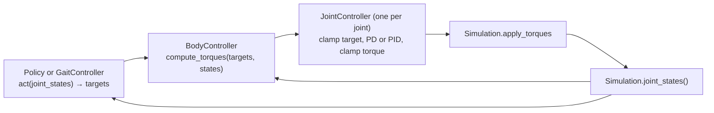

# Controllers

How joint targets become torques, and which classical controllers exist. Gains and limits are in
`configs/controller.yaml` and `configs/humanoid.yaml`, and the action and torque rules are in
[simulation-spec.md](simulation-spec.md).

## Layers

**Why it is split.** A policy only chooses target angles. The low-level controllers turn them into
torques the same way for every policy, so a hand-written gait and a learned policy are scored on the same
body.

## Shared interface

- **Policy** ([`agents/policy.py`](../src/humanoid_walk/agents/policy.py)): `act(states) → targets` (an
  angle in rad for every `JointName`) and `reset()`. `HoldPolicy` holds a fixed pose.
- **`GaitController`** has the same `act(joint_states)` and `reset()`, plus extra per-frame inputs
  (`set_torso`, `set_com`, `set_contacts`) and a clock (`step_clock`). It does not inherit from `Policy`
  yet.
- **`BodyController`** ([`controllers/joint_control.py`](../src/humanoid_walk/controllers/joint_control.py))
  checks that targets and states cover exactly the joints in `JointName`, then asks each joint's
  `JointController` for a torque.
- **`Controller`** ([`controllers/controller.py`](../src/humanoid_walk/controllers/controller.py)):
  `compute_action(target, state) → torque`. Implementations: `PController`, `PDController`,
  `PIController`, `PIDController`.

## Joint controllers

Each joint is assigned a gain set by the `joints:` lists in `controller.yaml` (every joint must appear in
exactly one list). `make_body_controller` builds one controller instance per joint, so a PID integral is
never shared between joints.

| Gain set    | Type | Joints                  |
| ----------- | ---- | ----------------------- |
| `PD_HIP`    | PD   | `hip_l`, `hip_r`        |
| `PID_LEG`   | PID  | `knee_l`, `knee_r`      |
| `PD_ANKLE`  | PD   | `ankle_l`, `ankle_r`    |
| `PD_ARM`    | PD   | `shoulder_l/r`          |
| `PD_NECK`   | PD   | `neck`                  |
| `PD_LEG`    | PD   | none (kept for switching the knees back) |

- **Derivative gain is limited by the step.** Each PD controller is explicit (it reads the state, then
  applies a torque), so `Kd · dt / inertia` must stay below 2 or the joint oscillates. The comments in
  `controller.yaml` give the figure for each group.
- **The PID integral is never reset.** `Controller.reset()` exists but nothing calls it, so the integral
  carries over between gait phases and only `integral_limit` bounds it. `App.reset` builds fresh
  controllers, so a viewer reset clears it.
- **`damping` and `friction`** in `humanoid.yaml` joint entries are not used in the torque calculation
  (only the first friction entry is read, for the body shapes).

## Controllers

- **Gait controller (foot trajectory + balance feedback):** see [gait.md](gait.md).
- **PID:** the joint-level PD and PID controllers above.
- **LQR / inverted pendulum (ZMP):** not implemented.
- **Central pattern generator (oscillator gait):** not implemented.

## Comparing against RL

Not implemented. Planned metrics: speed, cost of transport and fall rate, on the shared environment.
