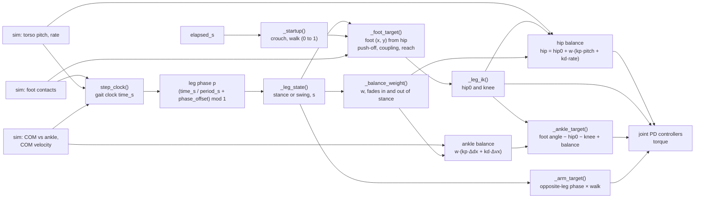
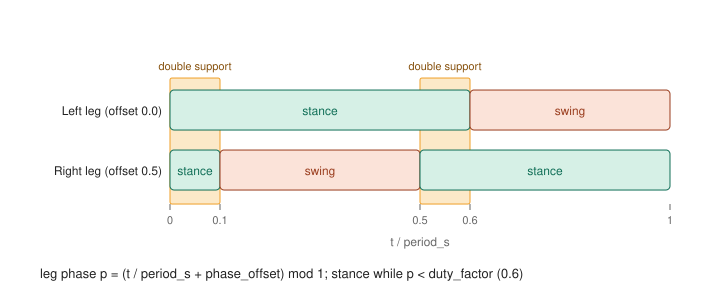
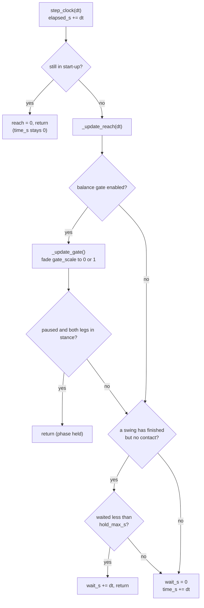
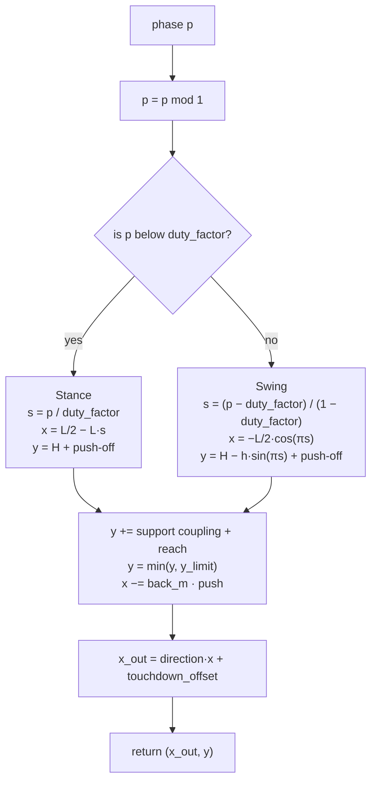
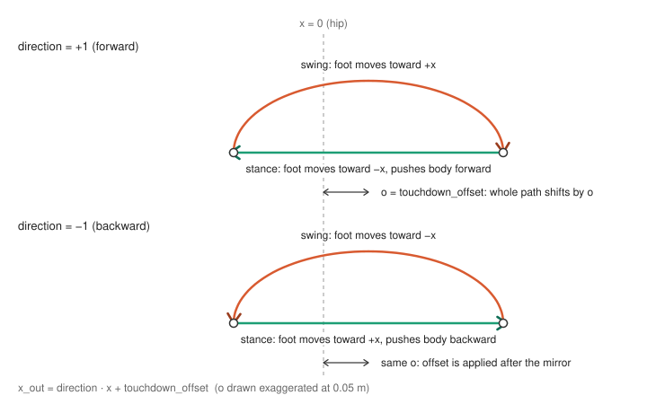
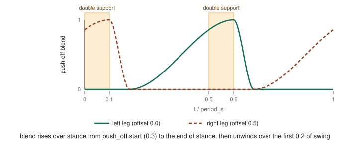
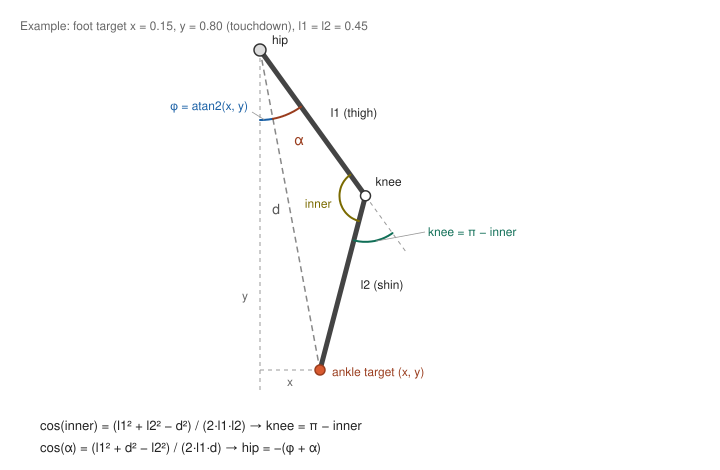
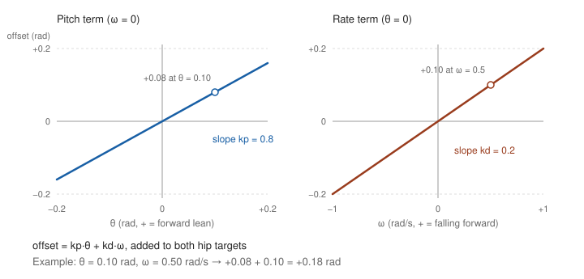

# Gait: foot trajectory, clock, push-off, balance and arm swing

How the gait controller turns a **clock** into a **foot target**, then into joint targets, how feedback keeps the body upright, and how the arms swing. The foot target is converted to hip and knee angles by inverse kinematics (IK, solving for joint angles that put the foot at a chosen point).

The code is `GaitController` in [`controllers/gait.py`](../src/humanoid_walk/controllers/gait.py). Its settings are in [`configs/gait.yaml`](../configs/gait.yaml) and are validated by `validate_gait` in [`config.py`](../src/humanoid_walk/config.py).

| Section                          | Code                                                          |
| -------------------------------- | ------------------------------------------------------------- |
| 3 Start-up and the clock         | `_startup`, `step_clock`, `_update_gate`, `_awaiting_touchdown` |
| 4 Foot path                      | `_foot_target`, `_push_off`, `_support_coupling`, `_update_reach` |
| 5 Inverse kinematics             | `_leg_ik`                                                     |
| 6 Ankle target                   | `_ankle_target`                                               |
| 7 Balance                        | `_balance_weight`, balance terms in `_leg_targets`            |
| 8 Arms                           | `_arm_target`                                                 |

Figures live in `resources/`. Mermaid diagrams render in VS Code with a Mermaid preview extension and on GitHub.

## 1. Pipeline

**Why it exists.** A walking leg needs a hip, knee and ankle angle at every instant. Choosing those three angles by hand is hard to tune. It is easier to describe where the foot should be, and let IK find the angles.



Each leg has its own phase `p` in `[0, 1)`. One full cycle is `period_s` seconds. The right leg runs behind the left by its `phase_offset`.



With a leg offset of 0.5, both feet are on the ground for `duty_factor − 0.5` of the cycle twice per period (double support, total `2 · (duty_factor − 0.5)`). Note that if `duty_factor` is below 0.5 both feet are in the air twice per cycle, and the balance gate (section 3.4) stops updating during that time.

### Per-frame order

`App.run` calls the controller once per frame in this order:

1. `set_torso(pitch, rate)`: torso angle and angular velocity.
2. `set_com(dx, vx, height)`: COM x relative to each ankle (a dict keyed by ankle joint), COM x velocity, and COM height above the ankle.
3. `set_contacts(left, right)`: foot contact flags. Optional. Without it the touchdown is open loop (section 3.3).
4. `act(joint_states)`: compute all joint targets. The joint states are unused.
5. `Simulation.control_step`: several physics substeps with those targets held constant.
6. `step_clock(1 / sim_hz)`: advance the clocks.

## 2. Parameters

Every setting in `gait.yaml`. Values live in the YAML only. Lengths are in m, times in s, angles in rad.

| YAML key                          | Unit   | Meaning                                                                             |
| --------------------------------- | ------ | ----------------------------------------------------------------------------------- |
| `period_s`                        | s      | Time for one full gait cycle (T)                                                    |
| `duty_factor`                     | 0 to 1 | Fraction of the cycle spent in stance                                               |
| `step_length_m`                   | m      | Total foot travel in stance, front to back (L)                                      |
| `step_height_m`                   | m      | Peak foot lift in swing (h)                                                         |
| `hip_height_m`                    | m      | Hip-to-ankle distance in stance (H)                                                 |
| `touchdown_offset_m`              | m      | Shifts the whole foot path forward (+) or back (−) of the hip                       |
| `max_leg_ratio`                   | 0 to 1 | The commanded leg is never longer than this × `leg_length_m`                        |
| `balance_blend`                   | 0 to ½ | Fraction of stance over which balance terms fade in and out                         |
| `ankle.stance_angle`              | rad    | Foot angle relative to the ground in stance (0 is flat)                             |
| `ankle.swing_angle`               | rad    | Peak foot angle relative to the ground in swing (negative is toes up)               |
| `ankle.pitch_ref`                 | 0 to 1 | Share of the torso pitch subtracted from the ankle target (section 6)               |
| `legs.left/right.phase_offset`    | 0 to 1 | Per-leg offset as a fraction of the cycle. Loaded as `phase_offsets` in the config  |
| `backward.*`                      | m      | `step_height_m` and `touchdown_offset_m` used when `direction = −1`                 |
| `hip_balance.*`                   |        | `kp`, `kd`, `max_correction` (rad cap), `enabled` (section 7.2)                     |
| `ankle_balance.*`                 |        | `kp`, `kd`, `com_offset_m`, `max_correction` (rad cap), `enabled` (section 7.3)     |
| `stand_only`                      | bool   | If true, no walking gait is applied                                                 |
| `arm.*`                           |        | `amplitude` (rad), `enabled` (section 8)                                            |
| `balance_gate.*`                  |        | `enabled`, `stop_margin`, `resume_margin`, `blend_s` (section 3.4)                  |
| `start_up.*`                      |        | `stand_s`, `crouch_s`, `ramp_s` (s), `start_phase` (0 to 1) (section 3.1)           |
| `push_off.*`                      |        | `start`, `extend_m`, `back_m`, `ankle_angle`, `unwind` (section 4.3)                |
| `touchdown.*`                     |        | `landing_start`, `reach_*`, `hold_*` (sections 3.3 and 4.4)                         |
| `foot_placement.*`                |        | `gain`, `max_m`, `deadband_mps` (section 4.5)                                       |

`direction` (+1 forward, −1 backward) is a constructor argument of `GaitController`, not a config key. `App` never changes it from +1.

Derived inside the functions: `half = L · walk / 2` (m), and `s` (0 to 1), the progress through the current stance or swing.

**Stand only.** When `stand_only` is set, the constructor zeroes `step_length_m`, `step_height_m` and `ankle.swing_angle`, the arms are disabled, and every leg is treated as in stance. The feet hold a fixed pose under the hip.

## 3. Start-up and the clock

### 3.1 Start-up sequence

**Why it exists.** Starting a full stride from a standing start tips the body over. The controller eases in instead.

`elapsed_s` always runs. `time_s` (the gait clock) stays at 0 until the sequence ends.

| Stage   | Time                                    | What happens                                                                    |
| ------- | --------------------------------------- | ------------------------------------------------------------------------------- |
| Stand   | `0` to `stand_s`                        | Legs straight (`y = leg_length_m`)                                              |
| Crouch  | `stand_s` to `stand_s + crouch_s`       | `crouch` eases 0 to 1, so the hip lowers to `hip_height_m`                      |
| Ramp    | after the crouch, for `ramp_s`          | `walk` eases 0 to 1. It scales step length, step height, swing angle, arm swing, push-off and the ankle reference speed |

Both ramps are a smoothstep, `x²(3 − 2x)`, which has zero slope at both ends.

**Start phase.** The gait clock starts at `start_up.start_phase · period_s` when the crouch ends, so `start_phase` chooses which leg steps first and how soon. At 0 the left leg starts at touchdown and the right leg is already late in stance (83% through with the old `duty_factor` of 0.6, 71% with 0.7), so the right foot lifts after about `0.1 · period_s`, while the body is still at rest and the step length is still near 0. The falls observed with that start were backward: the swing foot landed ahead of a COM that had not yet picked up speed, and the body tipped over it. The configured value (0.48) starts the right leg at the end of its swing, so it lands almost at once and carries weight through a double-support period (about `0.2 · period_s`) before the left foot lifts. This was found by search, not derived: the falls clustered in the first steps, and this start survived. It has not been compared against changing only the start phase.

### 3.2 The clock



### 3.3 Touchdown hold (needs `set_contacts`)

**Why it exists.** If a swing foot has not reached the floor when its swing ends, running on would start the next stance with that foot still in the air.

When a leg is in swing with `s ≥ touchdown.hold_from` and its foot has no contact, the whole clock waits, for at most `touchdown.hold_max_s`. After that the clock carries on, so a missing contact never freezes the gait. Both legs freeze together because there is one clock.

Without `set_contacts` (`contacts is None`) nothing waits and the reach (section 4.4) stays 0.

### 3.3.1 Limitation: the contact flag is noisy

`Simulation.feet_on_ground` reports whether the foot has any pymunk arbiter (a collision record) at the end of the last substep. A resting foot only reports contact in some frames (measured about 8% of frames while standing). So the hold can wait for the full `hold_max_s` at the end of most swings even when the foot is down.

### 3.4 Balance gate

**Why it exists.** If the body is already falling forward, taking another step on the clock's schedule makes it worse. The gate pauses the clock so the feet can settle.

When `balance_gate.enabled` is 1:

1. The capture point (where the COM would come to rest on a point foot) is `cp = com_vx / ω` from the COM, with `ω = √(g / com_height)`.
2. The support area runs from the rearmost stance heel to the foremost stance toe. Stance is decided by the clock, not by contacts.
3. `margin` is the distance from `cp` to the nearest edge, negative if outside.
4. The gate pauses when `margin < stop_margin` and resumes when `margin ≥ resume_margin`. The two thresholds are a hysteresis (a dead band, so the state does not flicker).
5. `gate_scale` fades to 0 (paused) or 1 over `blend_s`, and multiplies `walk`, so the feet are pulled back under the hips while paused.
6. The clock only holds when both legs are in stance. At other times a pause only fades the gait out.

**Limitations.** The foot extent assumes forward walking (`heel` behind, `toe` ahead), so `direction = −1` is not handled. If `duty_factor` is below 0.5 there are moments with no stance leg, and the gate keeps its last state.

## 4. Foot path

The output `(x, y)` is the **ankle target relative to the hip**, in metres. `x` is positive forward and `y` is positive **down**, so `y = H` means the foot is at ground level.


- Stance is the straight line at `y = H`. It runs from `x = +L/2` (phase 0) to `x = −L/2` (phase `duty_factor`).
- Swing is the arch. It runs from `x = −L/2` back to `x = +L/2`, rising by at most `h`, so `y` dips to `H − h`.

### 4.1 Deriving the base path




**Step 1: choose stance or swing.** Stance if `p < duty_factor`, otherwise swing. During start-up every leg counts as stance with `s = 0`.

**Step 2: normalise to `s`.** Inside each sub-phase, `s` runs from 0 to 1 so the same formulas work for any duty factor.

**Step 3: stance.** The foot is on the ground, so it must slide backward under the hip at constant speed. A straight line from `+L/2` to `−L/2` does that:

`x = L/2 − L·s`, `y = H`

The foot speed relative to the hip is `L / (duty_factor · T)`, which equals the walking speed.

**Step 4: swing x.** A linear sweep would start and stop abruptly, which slaps the foot and jerks the joints. A cosine ease has zero slope at both ends, so the foot leaves and lands with zero forward speed:

`x = −(L/2) · cos(πs)`

**Step 5: swing y.** `sin(πs)` is 0 at both ends and 1 at mid swing, and `y` points down, so the lift is subtracted:

`y = H − h·sin(πs)`


**Step 6: direction and offset.** `x_out = direction · x + touchdown_offset`. `direction = −1` mirrors the sweep about the hip, so stance pushes the body backward. `touchdown_offset` is added after the mirror. When `direction = −1`, `backward.step_height_m` and `backward.touchdown_offset_m` replace the forward values.



**Continuity.** Stance ends at `(−L/2, H)` and swing starts there. Swing ends at `(+L/2, H)` and the next stance starts there, so the foot target never jumps.

### 4.2 Leg length limit

`y` is capped at `y_limit = max(max_leg_ratio · leg_length_m, hip_height)`. A fully straight leg is a singularity (the knee angle changes very fast for a tiny change in reach), so the target stays slightly short of it. During the stand stage the hip height is the full leg length, so the second term wins and the legs stand straight.

`validate_gait` rejects a config whose worst-case reach (`hip_height_m + extend_m + reach_max_m`, and the diagonal including `step_length_m / 2`, the offsets and `back_m`) is beyond `y_limit`.

### 4.3 Push-off

**Why it exists.** A foot that only slides backward at constant height gives the body no extra thrust. Lengthening the stance leg at the end of stance (a calf push) adds forward drive.

`_push_off` returns a blend between 0 and 1, multiplied by `walk`:

- **Stance:** a smoothstep from `push_off.start` (a fraction of stance) up to 1 at the end of stance.
- **Swing:** `1 − smoothstep` over the first 0.2 of swing, so the leg unwinds after lift-off and the target stays continuous.



The blend scales three things:

- `extend_m`: extra drop of the foot target (the leg lengthens).
- `back_m`: extra backward foot reach (`x −= back_m · push`).
- `ankle_angle`: extra foot angle, + toes down (section 6).

**Support coupling.** Lengthening one leg lifts the pelvis, so the other leg has to reach lower or its foot loses the floor. `_support_coupling` adds a drop of `max(0, extension_other − extension_self)` to the foot target. In stance it applies fully. In swing it ramps in from `touchdown.landing_start`, so it is continuous at touchdown. Each extension is measured after the `y_limit` cap.

**Limitation.** The coupling assumes the pelvis rises by exactly the other leg's commanded extension. A leg that has not tracked its command (PD lag, torque limits) breaks that.

### 4.4 Contact-seeking reach

Needs `set_contacts`. In late swing (`s ≥ touchdown.reach_start`) with no contact, the foot target drops further at `reach_rate_mps`, up to `reach_max_m`. After touchdown (or early in the next swing) it unwinds over `reach_decay_s`. With `reach_max_m = 0` this is off.

### 4.5 Foot placement

**Why it exists.** A walker stays up mainly by putting its next foot where the body is heading. If a push makes the COM faster than planned, a foot that still lands at the planned spot is too far back to catch it.

**What it does.** During swing the landing spot is shifted by the capture point error (the COM speed error divided by `ω`, where `ω = √(g / com_height)`):

`shift = clamp(gain · (com_vx − vx_ref − deadband) / ω · walk, ±max_m)`

A COM that is faster than planned lands the foot further ahead, which brakes the body. A slower COM lands it nearer. `vx_ref` is the planned speed (section 7.3). Speed errors smaller than `deadband_mps` are ignored, so normal walking is left as tuned.

**How it works in code** (`_foot_target`, `_landing_shift`). The swing path starts at the lift-off spot and ends at the shifted landing spot, so the shift fades in smoothly:

```
lift_x = −half + stance_shift          # where the last stance ended
land_x =  half + shift                 # shift is recomputed every frame of the swing
x = lift_x + (land_x − lift_x) · (1 − cos(πs)) / 2
```

The shift at the end of the swing is latched when the foot lands. The stance then sweeps from `half + stance_shift` at the same speed as before, so the shift moves the stance forward or back and does not change the walking speed.

**Why this approach.** Making the stance sweep longer instead would also speed the body up, and a faster body needs an even longer step. The shifted stance has no such feedback.

**Limitations.**
- The COM speed is read once per frame with no filtering, so it includes the normal speed ripple within a stride. The deadband hides that ripple.
- In simulation it improved recovery from forward pushes (18 of 30 whole-body pushes survived against 13 without it), with little change for backward pushes (15 against 14).
- The shift is capped by `max_m` and by the leg reach (`validate_gait` includes it).

## 5. Inverse kinematics

`_foot_target` returns where the ankle should be. `_leg_ik` converts that into the hip and knee angles the joint controllers track.

| Argument | Unit | Meaning                                   |
| -------- | ---- | ----------------------------------------- |
| `x`      | m    | Ankle target, + forward of the hip        |
| `y`      | m    | Ankle target, + down from the hip         |
| `t`, `sh`| m    | Thigh and shin length, from `leg_length_m` |

Returns `hip` and `knee` in rad: + hip swings the leg backward, + knee flexes the shin backward, and 0 knee is a straight leg.



Thigh, shin and the hip-to-ankle line `d` form a triangle.

**Step 1: distance to the foot.** `d = hypot(x, y)`, clamped to `[|t − sh| + ε, t + sh − ε]` so the target is always reachable and `acos` never gets a value outside [−1, 1].

**Step 2: angle at the hip between the thigh and `d`.** From the law of cosines:

`β = acos((t² + d² − sh²) / (2·t·d))`

**Step 3: knee.** The angle at the knee between thigh and shin is `γ = acos((t² + sh² − d²) / (2·t·sh))`. The config measures flexion from a straight leg, so `knee = π − γ`. A straight leg (`d = t + sh`) gives `γ = π` and `knee = 0`.

**Step 4: hip.** `φ = atan2(x, y)` is the direction from the hip to the foot, positive when the foot is forward. The knee bends so the shin swings backward, so the thigh always points forward of that line by `β`. The config counts forward as negative, so:

`hip = −(φ + β)`

The simulation builds equal thigh and shin lengths, so `β` reduces to `acos(d / 2l)`.

**Notes.**

- Two solutions exist for any reachable target (knee bent forward or backward). The formulas always give a non-negative knee, the human-style solution.
- The result assumes an upright torso. Section 6 explains what this means for the ankle.

## 6. Ankle target

The ankle holds the foot at a chosen angle relative to the ground, whatever the hip and knee are doing.

`stance_angle` and `swing_angle` are foot angles relative to the ground, not joint angles.


**Step 1: foot angle target.**

- Stance: `stance_angle`.
- Swing: `swing_angle · walk · sin(πs)`. This is 0 at lift-off and touchdown, so there is no jump at either join.
- Both: plus `push_off.ankle_angle · push` (section 4.3).

**Step 2: solve for the ankle.** Every joint angle is child minus parent, and positive turns the child clockwise on screen. The foot's angle is the sum down the chain from the torso:

`foot_angle = torso_pitch + hip + knee + ankle`

The code drops `torso_pitch` and uses the nominal `hip0` (before the hip balance term), so:

`ankle = foot_angle − hip0 − knee0 + balance`

**Step 3: clamp** the result to the ankle joint limits.

**`pitch_ref`.** The ankle target also subtracts `pitch_ref · torso_pitch`, so with `pitch_ref = 1` the foot angle follows the ground when the torso leans. The configured value is small (0.17).

**Limitation: the foot is not fully ground-referenced.** The hip balance shift is not subtracted, so a hip balance shift of δ rotates a planted foot by up to δ, and with `pitch_ref < 1` a torso lean still rotates the foot. The hip and ankle terms were decoupled on purpose (so hip balance does not change the ankle balance term), but this stops the ankle holding the foot exactly flat. In the original configuration the standing foot sat about 0.14 rad toes down with the heel lifted.

The body config's dorsiflexion limit must be wide enough for the knee flexion the gait needs. More knee flexion (a higher `step_height_m` or a lower `hip_height_m`) needs more dorsiflexion, otherwise the target clamps and the toes may drag in early swing.

## 7. Balance

### 7.1 Balance weight

**Why it exists.** Applying a balance correction to a leg that is about to lift off, or has just landed, makes the target jump.

`_balance_weight` returns `w`:

- Standing: 1.
- Swing: 0.
- Stance: a smoothstep up over the first `balance_blend` of stance, and down over the last `balance_blend`.

Both balance terms below are multiplied by `w`.

### 7.2 Hip balance (torso pitch)

After `_leg_ik`, each leg gets:

`hip_target = hip0 + clamp(w · (kp · pitch + kd · rate), ±0.5 rad)`

| Symbol  | Source                       | Unit        | Meaning                                      |
| ------- | ---------------------------- | ----------- | -------------------------------------------- |
| `pitch` | `sim.torso.angle`            | rad         | Torso angle, + is a forward (clockwise) lean |
| `rate`  | `sim.torso.angular_velocity` | rad/s       | Torso rotation speed, + is falling forward   |
| `kp`    | `hip_balance.kp`             | rad/rad     | Hip target shift per rad of lean             |
| `kd`    | `hip_balance.kd`             | rad/(rad/s) | Hip target shift per rad/s of rotation       |

`Simulation.apply_torques` applies each joint torque to the child body and the opposite torque to the parent. For the hip the child is the thigh and the parent is the torso.

1. The torso leans forward: `pitch > 0`.
2. The hip target moves positive, so the hip PD outputs a positive torque.
3. The thigh receives `+τ` (clockwise, leg swings backward) and the torso receives `−τ` (counterclockwise).
4. With the foot planted, the leg barely moves, so the torso takes the rotation and comes back upright.




**Limitations.** The gains are large (`kp` is in rad of hip per rad of lean, well above 1), so a lean of about 0.09 rad already saturates the 300 N·m hip torque limit. With `kd = 0.6` the simulated body fell within a fraction of a second of the walk starting. The targets are held for a whole frame, so the loop has a one-frame delay, which limits how much derivative gain it tolerates.

### 7.3 Ankle balance (COM position and velocity)

The ankle adds a second correction that acts on the whole body, using the COM position and velocity relative to the planted ankle.

`balance = clamp(w · (kp · (com_dx − dx_ref) + kd · (com_vx − vx_ref)), ±0.07 rad)`

| Symbol   | Meaning                                                                                     |
| -------- | ------------------------------------------------------------------------------------------- |
| `com_dx` | COM x minus that ankle's x, + when the COM is ahead (from `set_com`)                        |
| `com_vx` | COM x velocity, + when moving forward                                                       |
| `dx_ref` | Planned COM position relative to this ankle. The code uses `−x`, the COM directly over the hip |
| `vx_ref` | Planned COM speed: `direction · L · walk / (duty_factor · T)`                               |

`balance` is passed into `_ankle_target`. The ankle uses `hip0` rather than the balance-corrected hip.


- **COM ahead.** `balance` is positive and the target moves toes-down. The foot is planted, so the ankle torque on the foot (clockwise) is matched by the opposite torque on the shin. This rotates the shin and the body above it backward, which brings the COM back over the ankle.
- **COM behind.** `balance` is negative and the target moves toes-up. The shin and body are pushed forward.

**`com_offset_m`.** The planned COM is not over the hip. In the standing pose the whole-body COM sits about 0.07 m ahead of the ankle, because the knees are flexed and the thighs and shins lie forward of the hip-ankle line. So `dx_ref = −x + com_offset_m`. With the offset at 0 the correction sat at its cap from the first frame and had no headroom to correct a forward lean. The offset is a constant, so it is only right for the configured pose.

**Other limits.**

- The target is clamped to the ankle joint limits.
- The torque is clamped to the joint's `max_torque`. If the ankle is already saturated, raising the gains does nothing.

## 8. Arm control

The arms swing to counter the angular momentum of the legs. They are open loop: no torso or COM feedback is applied. Each arm runs half a cycle out of phase with the same-side leg, so it moves in the opposite direction.

`arm_phase = (time_s / T + arm.phase_offset) mod 1`

`shoulder = −direction · amplitude · walk · cos(2π · arm_phase)`

`arm.phase_offset` is the phase offset of the **opposite** leg (the left arm uses the right leg's offset, and vice versa). With a 0.5 leg offset, `cos(x + π) = −cos(x)`, so the arm mirrors the same-side leg's forward/back position.

The leading minus is there because the shoulder follows the same convention as the hip: + is backward (clockwise), − is forward (counterclockwise). `walk` ramps the swing in over start-up.

**Why a cosine.** The foot x goes from forward (phase 0) to back (phase `duty_factor`) and returns, so its shape is close to `cos(2π p)`. A continuous cosine has no jump at any phase and keeps the shoulder PD target smooth. The arm does not use the stance/swing split.

| Left leg phase | Left leg foot | Left arm shoulder sign |
| -------------- | ------------- | ---------------------- |
| 0.0            | forward       | + (arm back)           |
| 0.25           | mid stance    | 0                      |
| 0.5            | back          | − (arm forward)        |

- **Disabled and stand only.** `arm.enabled = 0` or `stand_only` holds the arms at 0.
- **Limits.** The target is clamped to the shoulder limits, so keep `amplitude` inside them.
- **No balance term.** The arms do not react to torso pitch or COM, and they pause with the clock when the clock holds.

## 9. Debugging

- `stand_only: true` holds a fixed pose, which isolates the balance terms from the stepping.
- `hip_balance.enabled` and `ankle_balance.enabled` switch each balance term off.
- `pin_torso: true` in `humanoid.yaml` holds the torso upright, which tests propulsion without balance.
- `print_walk_state` in [`viewer/render/debug.py`](../src/humanoid_walk/viewer/render/debug.py) prints the clocks, gate state, per-leg phase, contact, targets, actual angles and torques every 20 frames. A target within 0.02 rad of a joint limit is flagged `PINNED`.

## 10. Limits and notes

- **Reachability.** `_leg_ik` clamps the hip-to-ankle distance, so an unreachable target never breaks `acos`. Check the knee limit again if `step_length_m` or `hip_height_m` change.
- **Speed and direction** come from `step_length_m`, `period_s`, `duty_factor` and the sign of `direction`.
- **Balance is feedback only.** There is no foot-placement feedback, so a large push can still topple the body.
- **Not geometric compensation.** The corrections are righting terms. They do not make the foot target geometrically correct for a tilted torso (see the limitation in section 6).
- **Balance runs in stance only,** faded in and out by section 7.1, so it does not disturb the swing arch.
- **One clock for both legs.** The touchdown hold and the gate freeze both legs together, including a leg in late stance.
- **Weight shift is implicit.** There is no explicit weight-shift state. The clock simply starts at `start_phase` (section 3.1), and the balance terms do the rest.
- **Foot placement only reacts to COM speed.** It does not look at the COM position, and it does not help much against a backward push (section 4.5).

## 11. Tuning

The gait is sensitive to its settings: a poor combination falls within a few steps. These rules came out of a search over the settings in a headless simulation (`tests/test_walk.py` runs the same loop).

- **Test robustness, not one run.** Judge a setting by whether it still walks when every value is changed by a few percent. A tune that only works at exact values is not usable, because the simulation is chaotic.
- **Start-up decides most outcomes.** A body that survives the first two steps keeps walking. Tune `start_phase` and `ramp_s` first.
- **Damp the ankle.** The foot is light, so with `Kd` too small the ankle chatters between its torque limits. Raise `PD_ANKLE.Kd` as far as `Kd · dt / inertia < 2` allows.
- **Retune after a body change.** The gains depend on the body mass, leg length and step size (see `AGENTS.md`).
