# Gait: foot trajectory and torso balance

How the gait controller turns a **phase** into a **foot target**, then into joint targets, and how torso feedback keeps the body upright. The foot target is converted to hip and knee angles by inverse kinematics (see `controllers.md`).
See `gait.py` in `/controllers` for `foot_target` (section 4), `leg_ik` (section 5), `ankle_target` (section 6) and the balance term in `GaitController._leg_targets` (section 7).

Figures live in `resources/`. Mermaid diagrams render in VS Code with a Mermaid preview extension and on GitHub.

## 1. Pipeline

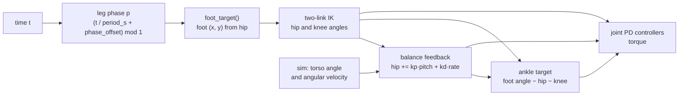

Each leg has its own phase `p` in `[0, 1)`. One full cycle is `period_s` seconds. The right leg uses `phase_offset = 0.5`, so it runs half a cycle behind the left.

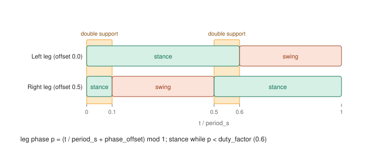

With `duty_factor = 0.6` both feet are on the ground for 0.1 of the cycle twice per period (double support). In general it is `2 · (duty_factor − 0.5)` of the cycle when the offset is 0.5.

## 2. Parameters

Every parameter used by `foot_target`, with the matching key in the gait YAML.

| Argument           | Symbol | Unit     | Meaning                                                  | YAML key                                |
| ------------------ | ------ | -------- | -------------------------------------------------------- | --------------------------------------- |
| `phase`            | p      | 0 to 1   | Position in the gait cycle, wrapped with `mod 1`         | derived from `period_s`, `phase_offset` |
| `step_length`      | L      | m        | Total foot travel from the front of stance to the back   | `step_length_m`                         |
| `step_height`      | h      | m        | Peak foot lift during swing                              | `step_height_m`                         |
| `hip_height`       | H      | m        | Hip-to-ankle distance while the foot is on the ground    | `hip_height_m`                          |
| `duty_factor`      | duty   | 0 to 1   | Fraction of the cycle spent in stance                    | `duty_factor`                           |
| `touchdown_offset` | o      | m        | Shifts the whole path forward (+) or back (−) of the hip | `touchdown_offset_m`                    |
| `direction`        | d      | +1 or −1 | +1 walks forward, −1 mirrors the path to walk backward   | command, not config                     |

Derived inside the function: `half = L / 2` (m) and `s` (0 to 1, progress through the current sub-phase).

Balance gains (section 7) are attributes of `GaitController`, not YAML keys yet.

## 3. Coordinate frame

The output `(x, y)` is the **ankle target relative to the hip**, in metres. `x` is positive forward and `y` is positive **down**, so `y = H` means the foot is at ground level.

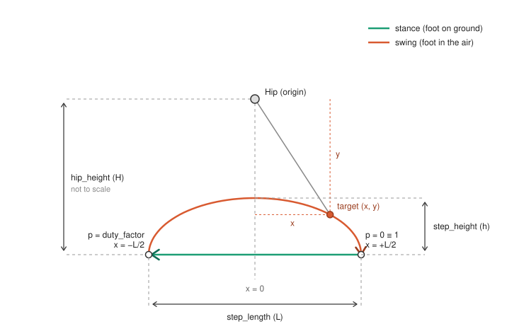

Reading the figure:

- Stance is the straight green line at `y = H`. It runs from `x = +L/2` (phase 0) to `x = −L/2` (phase `duty_factor`).
- Swing is the orange arch. It runs from `x = −L/2` back to `x = +L/2`, rising by at most `h`, so `y` dips to `H − h`.
- The `(x, y)` marked on the arch is exactly what the function returns for that phase.

## 4. Deriving the function

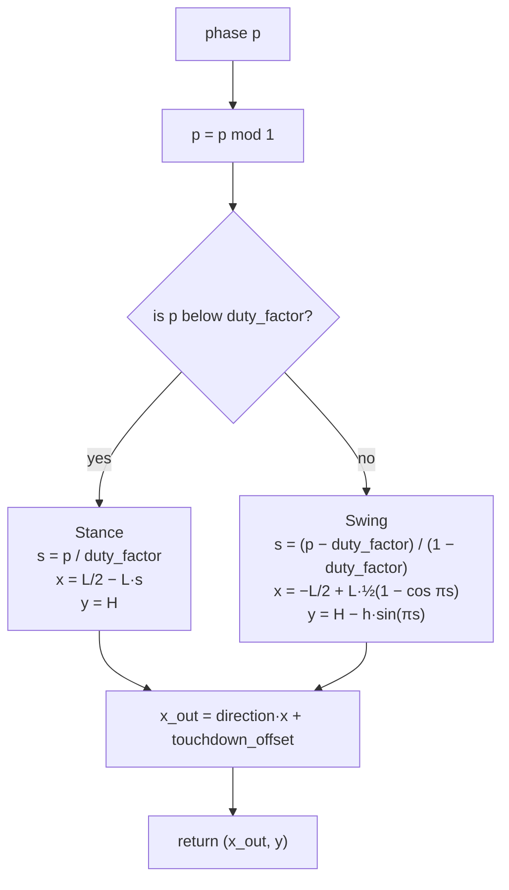

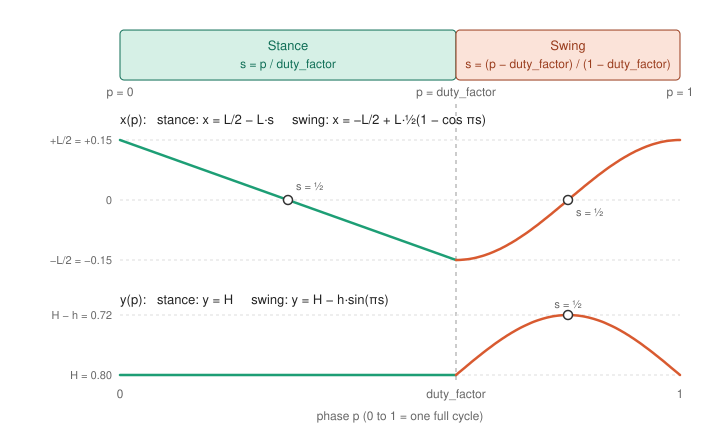

**Step 1: wrap the phase.** `p = phase mod 1` keeps `p` in `[0, 1)`, so any phase value, including a growing clock, is valid.

**Step 2: choose stance or swing.** Stance if `p < duty_factor`, otherwise swing. This sets how long the foot is on the ground.

**Step 3: normalise to `s`.** Inside each sub-phase, `s` runs from 0 to 1 so the same formulas work for any duty factor.

- Stance: `s = p / duty_factor`
- Swing: `s = (p − duty_factor) / (1 − duty_factor)`

**Step 4: stance.** The foot is on the ground, so it must slide backward under the hip at constant speed. A straight line from `+L/2` to `−L/2` does that:

`x = L/2 − L·s`, `y = H`

Check: `s = 0` gives `+L/2`, `s = ½` gives `0`, `s = 1` gives `−L/2`. The foot speed relative to the hip is `L / (duty_factor · period_s)`, which equals the walking speed (0.5 m/s with the default config).

**Step 5: swing x.** The foot must go from `−L/2` to `+L/2`. A linear sweep would start and stop abruptly, which slaps the foot and jerks the joints. Use the cosine ease instead:

`e(s) = ½(1 − cos πs)`, so `x = −L/2 + L·e(s)`

`e(0) = 0`, `e(1) = 1` and its slope `e'(s) = (π/2)·sin πs` is 0 at both ends. The foot therefore leaves and lands with zero forward speed.

**Step 6: swing y.** The foot must lift and return to the ground. `sin(πs)` is 0 at both ends and 1 at `s = ½`, so `lift = h·sin(πs)`. Because `y` points down, the lift is subtracted:

`y = H − h·sin(πs)`

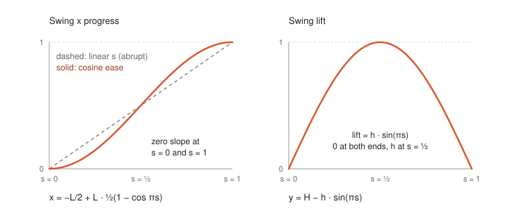

**Step 7: direction and offset.** The final x is

`x_out = direction · x + touchdown_offset`

`direction = −1` mirrors the sweep about the hip, so stance now moves the foot toward `+x` and pushes the body backward. `touchdown_offset` is added after the mirror, so it shifts the path in the hip frame regardless of direction.

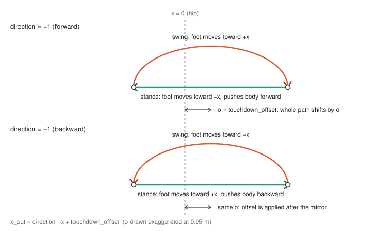

**Continuity.** Stance ends at `(−L/2, H)` and swing starts there. Swing ends at `(+L/2, H)` and the next stance starts there. Both joins sit at `y = H`, so the foot target never jumps.

## 5. Inverse kinematics

`foot_target` returns where the ankle should be. `leg_ik` converts that into the hip and knee angles the joint controllers track.

| Argument | Symbol | Unit | Meaning                                 |
| -------- | ------ | ---- | --------------------------------------- |
| `x`      | x      | m    | Ankle target, + forward of the hip      |
| `y`      | y      | m    | Ankle target, + down from the hip       |
| `l1`     | l1     | m    | Thigh length, `leg_length_m / 2` (0.45) |
| `l2`     | l2     | m    | Shin length, `leg_length_m / 2` (0.45)  |

Returns `hip` and `knee` in rad, using the joint conventions in the body config: + hip swings the leg backward, + knee flexes the shin backward, and 0 knee is a straight leg.

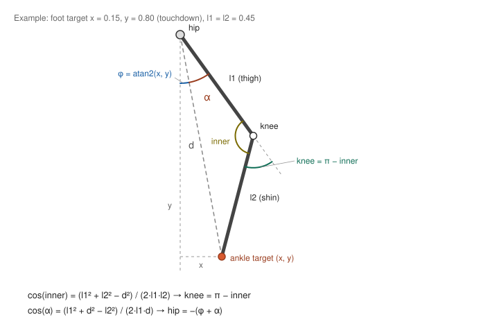

The figure uses the touchdown target (x = 0.15, y = 0.80). Thigh `l1`, shin `l2` and the hip-to-ankle line `d` form a triangle. `φ` is the angle from straight down to `d`, `α` is the angle at the hip between `d` and the thigh, and `inner` is the angle at the knee. The hip target is `−(φ + α)` and the knee target is `π − inner`, which are the values in the checks table below.

**Step 1: distance to the foot.** `d = sqrt(x² + y²)`. Clamp it to `[|l1 − l2| + ε, l1 + l2 − ε]` so the target is always reachable and `acos` never receives a value outside [−1, 1].

**Step 2: knee.** The hip, knee and ankle form a triangle with sides `l1`, `l2` and `d`. The law of cosines gives the inner angle at the knee:

`cos(inner) = (l1² + l2² − d²) / (2·l1·l2)`

The config measures knee flexion from a straight leg, so `knee = π − inner`. A straight leg (`d = l1 + l2`) gives `inner = π` and `knee = 0`.

**Step 3: hip.** Two angles add up, both measured from straight down:

- `φ = atan2(x, y)` is the direction from the hip to the foot, positive when the foot is forward.
- `α` is the angle at the hip between the thigh and that hip-to-foot line. The law of cosines gives `cos(α) = (l1² + d² − l2²) / (2·l1·d)`.

The knee bends so the shin swings backward, so the thigh always points forward of the hip-to-foot line by `α`. The thigh is therefore `φ + α` forward of vertical. The config counts forward as negative, so:

`hip = −(φ + α)`

**Checks** (`l1 = l2 = 0.45`):

| Foot target (x, y) | hip (rad) | knee (rad) | Meaning                          |
| ------------------ | --------- | ---------- | -------------------------------- |
| (0, 0.90)          | −0.001    | 0.003      | straight leg, fully extended     |
| (+0.15, 0.80)      | −0.626    | 0.882      | touchdown, thigh forward         |
| (0, 0.80)          | −0.476    | 0.952      | mid stance                       |
| (−0.15, 0.80)      | −0.256    | 0.882      | end of stance, thigh moving back |
| (0, 0.72)          | −0.644    | 1.287      | peak of swing, knee flexed most  |

**Notes.**

- Two solutions exist for any reachable target (knee bent forward or backward). The formulas above always give a non-negative knee, which is the human-style solution.
- These values assume an upright torso. Torso lean is handled by the balance term in section 7, which is applied after `leg_ik`.

## 6. Ankle target

The ankle holds the foot at a chosen angle relative to the ground, whatever the hip and knee are doing.

| Argument         | Symbol    | Unit         | Meaning                                                                        |
| ---------------- | --------- | ------------ | ------------------------------------------------------------------------------ |
| `hip`, `knee`    | hip, knee | rad          | Hip is the balance-corrected value (section 7), knee is straight from `leg_ik` |
| `in_stance`, `s` |           | bool, 0 to 1 | From the same phase split as `foot_target`                                     |
| `stance_angle`   |           | rad          | Foot angle relative to the ground in stance (0 is flat)                        |
| `swing_angle`    |           | rad          | Peak foot angle relative to the ground in swing (negative is toes up)          |
| `torso_pitch`    |           | rad          | Torso angle. `GaitController` does not pass it yet, so it stays 0              |
| `limits`         |           | rad          | Ankle joint limits from the body config                                        |

`stance_angle` and `swing_angle` are foot angles relative to the ground, not joint angles.

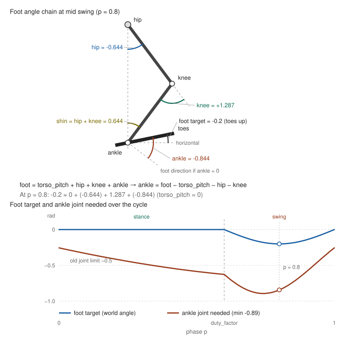

The top diagram shows the sum down the chain at mid swing. The plot shows the foot target (blue) and the ankle joint angle needed to hit it (orange). The orange curve dips to about −0.89 rad in swing, which is why the dorsiflexion limit has to be wider than ±0.5.

**Step 1: foot angle target.**

- Stance: `stance_angle`.
- Swing: `swing_angle · sin(πs)`. This is 0 at lift-off, toes-up `swing_angle` at mid swing, and 0 at touchdown, so the target has no jump at either join and the foot lands flat.

**Step 2: solve for the ankle.** Every joint angle is child minus parent, and positive turns the child clockwise on screen. The foot's world angle is therefore the sum down the chain:

`foot_angle = torso_pitch + hip + knee + ankle`

so `ankle = foot_angle − torso_pitch − hip − knee`.

**Step 3: clamp** the result to the ankle joint limits.

**Checks** (default gait, `swing_angle = −0.2`, no balance correction):

| p   | Phase       | hip    | knee  | foot target | ankle needed |
| --- | ----------- | ------ | ----- | ----------- | ------------ |
| 0.0 | touchdown   | −0.626 | 0.882 | 0           | −0.256       |
| 0.3 | mid stance  | −0.476 | 0.952 | 0           | −0.476       |
| 0.6 | lift-off    | −0.256 | 0.882 | 0           | −0.626       |
| 0.7 | early swing | −0.442 | 1.168 | −0.141      | −0.867       |
| 0.8 | mid swing   | −0.644 | 1.287 | −0.200      | −0.844       |
| 0.9 | late swing  | −0.725 | 1.168 | −0.141      | −0.583       |

The default gait needs the ankle between −0.26 and −0.89 rad over the cycle. The body config must therefore allow about 0.9 rad of dorsiflexion. With the original ±0.5 limit the target clamps from late stance through most of swing, leaving the toes pointing down in early swing.

### Ankle balance (stance only)

The hip term rotates the torso directly. The ankle adds a second correction that acts on the whole body, but only on the leg in stance.

**The balance term** is a correction added to the ankle target, proportional to how far and how fast the torso is tipping:

`balance = ankle_kp · pitch + ankle_kd · rate`

`ankle_target = foot_angle − torso_pitch − hip − knee + balance`

| Symbol             | Source           | Unit        | Meaning                                        | Initial value |
| ------------------ | ---------------- | ----------- | ---------------------------------------------- | ------------- |
| `ankle_balance_kp` | `GaitController` | rad/rad     | Ankle target shift per rad of lean             | 0.5           |
| `ankle_balance_kd` | `GaitController` | rad/(rad/s) | Ankle target shift per rad/s of torso rotation | 0.1           |

`pitch` and `rate` are the same measurements as in 7.1. The gains are untuned starting values. `balance` is passed into `ankle_target` through its `balance` argument. It is 0 when the leg is in swing, so it only changes the target while the foot is planted.


**Reading the figure.**

- **Panel 1, torso falls back.** The torso rotates backward about the hip, so `pitch < 0` (the arc), and the body is moving backward (the red arrow). `rate` is negative as well.
- **Panel 2, stance ankle reacts.** Both measurements are negative, so `balance` is negative. The ankle target moves toes-up (the dashed green line) relative to the shin. The foot stays on the ground, so `PD_ANKLE` produces a toes-up torque that rotates the shin and the body above it forward about the ankle (the green arrow). The heel takes more load as a side effect.

A forward fall flips both signs. `balance` becomes positive, the target moves toes-down, and the body is pushed backward.

**Why stance only.** In swing the foot is free, so the same torque would only move the foot and disturb the swing arch instead of moving the body.

**Limits.**

- The target is clamped to the ankle joint limits. The default gait already needs −0.26 to −0.89 rad of dorsiflexion (section 6), so there is little room left toward toes-up before the clamp.
- The torque is clamped to the joint's `max_torque`. If the ankle is already saturated, raising the gains does nothing.

## 7. Torso balance (stance only)

The foot path alone is open loop: nothing stops the torso pitching forward or backward. A small feedback term on the hip fixes this.

### 7.1 The law

After `leg_ik`, both legs get the same correction:

`hip_target = hip_ik + kp · pitch + kd · rate`

| Symbol  | Source                       | Unit        | Meaning                                      | Initial value |
| ------- | ---------------------------- | ----------- | -------------------------------------------- | ------------- |
| `pitch` | `sim.torso.angle`            | rad         | Torso angle, + is a forward (clockwise) lean | measured      |
| `rate`  | `sim.torso.angular_velocity` | rad/s       | Torso rotation speed, + is falling forward   | measured      |
| `kp`    | `balance_kp`                 | rad/rad     | Hip target shift per rad of lean             | 0.8           |
| `kd`    | `balance_kd`                 | rad/(rad/s) | Hip target shift per rad/s of rotation       | 0.2           |

The result is clamped to the hip limits by `JointController.clamp_angle`. The gains are untuned starting values.

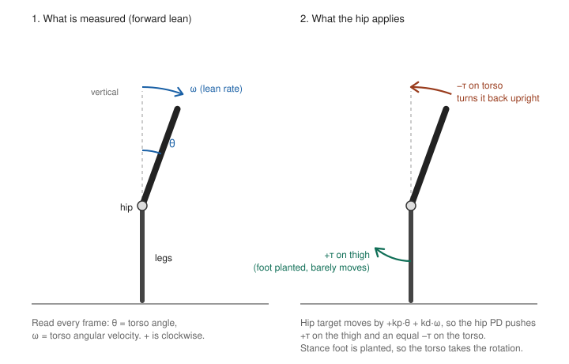

### 7.2 Why it works

`Simulation.apply_torques` applies each joint torque to the child body and the opposite torque to the parent. For the hip the child is the thigh and the parent is the torso.

1. The torso leans forward: `pitch > 0`.
2. The hip target moves positive, so the hip PD outputs a positive torque.
3. The thigh receives `+τ` (clockwise, leg swings backward) and the torso receives `−τ` (counterclockwise).
4. With the foot planted in stance, the leg barely moves, so the torso takes the rotation and comes back upright.

The `kd · rate` term acts early: it reacts to the speed of the lean before the angle has grown, and it damps the overshoot that `kp` alone would cause.

During swing the leg is light and free, so the same correction moves the leg more than the torso. Balance is mainly effective in stance.

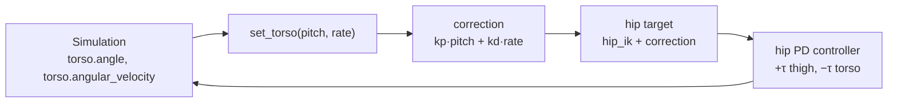

### 7.3 Size of the correction

Each term is a straight line through zero.

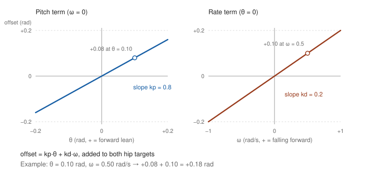

### 7.4 Where it runs

Once per frame, in `App.run`:

1. `gait.set_torso(sim.torso.angle, sim.torso.angular_velocity)` stores the latest lean.
2. `policy.act(...)` computes targets. `_leg_targets` adds the correction right after `leg_ik`.
3. `control_step` runs 8 substeps with those targets held constant.
4. `gait.step_clock(1 / sim_hz)` advances the gait phase.

### 7.5 Tuning

| Symptom                                   | Change                                                                                   |
| ----------------------------------------- | ---------------------------------------------------------------------------------------- |
| Falls faster than without the term        | The sign is wrong. Negate `kp` and `kd`.                                                 |
| Jitters or vibrates                       | Lower `kd` first.                                                                        |
| Still leans slowly until it falls         | Raise `kp`.                                                                              |
| Hip target pinned at a joint limit        | Lower `kp`, or reduce the lean source (gait speed, `hip_height_m`).                      |
| Still falls backward, ankle at max torque | The ankle is saturated. Raise the limits or reduce the lean source instead of the gains. |
| Ankle chatters in stance                  | Lower `ankle_balance_kd`.                                                                |
| Leans back more with the term on          | The sign is wrong. Negate `ankle_balance_kp` and `ankle_balance_kd`.                     |

## 8. Limits and notes

- **Reachability.** `leg_ik` clamps the hip-to-ankle distance to `[|l1 − l2| + ε, l1 + l2 − ε]`, so an unreachable target never breaks the `acos` calls. The maximum is thigh + shin = 0.9 m. The largest distance on the default path is 0.814 m, so the knee stays slightly bent and the straight-leg singularity is avoided. The largest knee angle on the default path is 1.29 rad, inside the `[0, 2.0]` limit. Check both again if `step_length` or `hip_height` grow.
- **Speed and direction** come from `step_length`, `period_s` and the sign of `direction`. Stance foot speed is `L / (duty_factor · period_s)`.
- **Torso only.** Balance feedback covers torso pitch. There is no foot-placement feedback, so a large push can still topple the body.
- **Feedback, not compensation.** The correction is a righting term. It does not make the foot target geometrically correct for a tilted torso, and `ankle_target` still receives `torso_pitch = 0`.
- **Same correction on both legs.** The swing leg gets the term too, which slightly disturbs the swing arch when the lean is large.
- **Ankle range.** The default gait needs −0.26 to −0.89 rad at the ankle, so the body config's dorsiflexion limit must allow at least 0.9 rad or the target clamps and the toes may drag in early swing. More knee flexion (a higher `step_height_m` or a lower `hip_height_m`) needs more dorsiflexion, so check this when those change.
