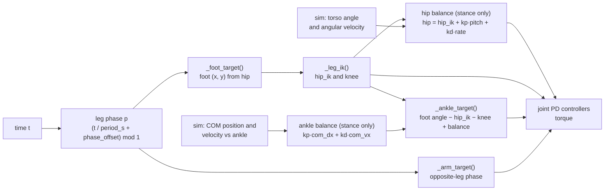
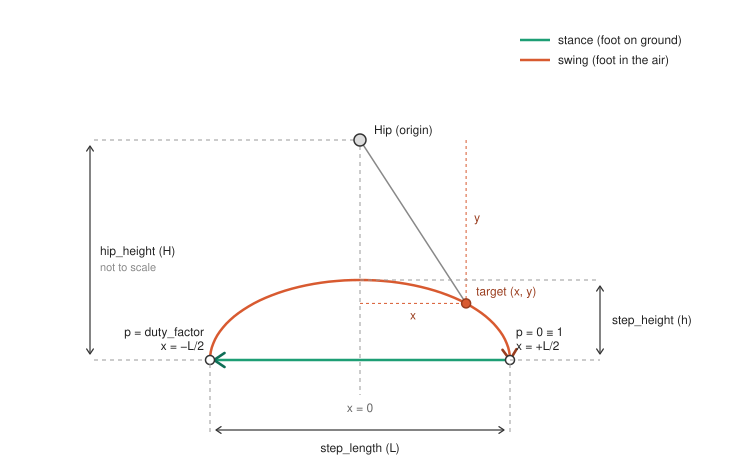
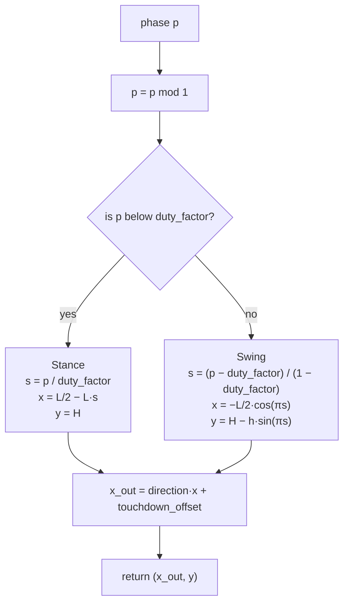
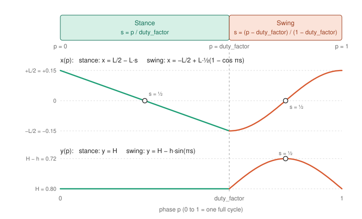
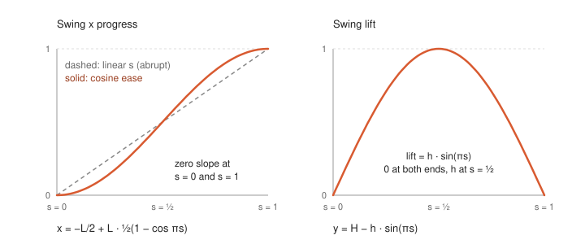
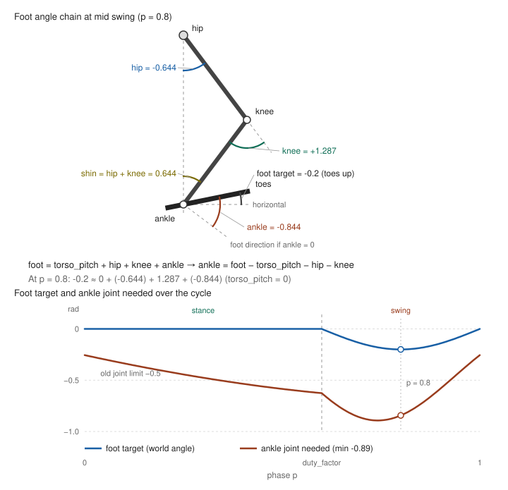
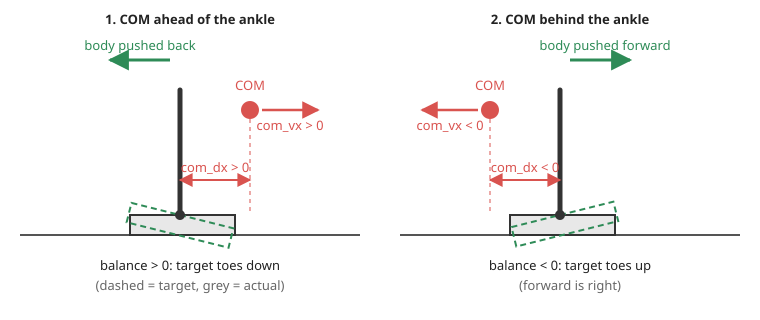
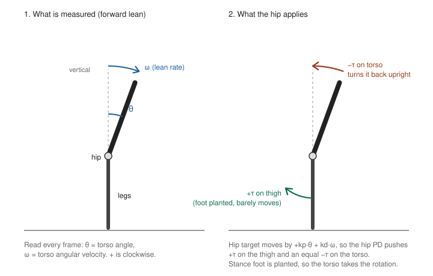
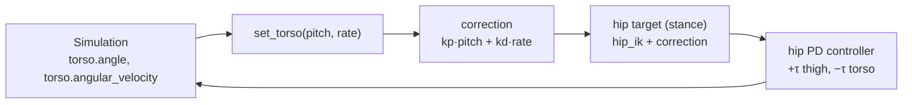

# Gait: foot trajectory, balance and arm swing

How the gait controller turns a **phase** into a **foot target**, then into joint targets, how feedback keeps the body upright, and how the arms swing. The foot target is converted to hip and knee angles by inverse kinematics (see `controllers.md`).

See `gait.py` in `/controllers` for `_foot_target` (section 4), `_leg_ik` (section 5), `_ankle_target` (section 6), the balance terms in `GaitController._leg_targets` (sections 6 and 7) and `_arm_target` (section 8).

Figures live in `resources/`. Mermaid diagrams render in VS Code with a Mermaid preview extension and on GitHub.

## 1. Pipeline

Each leg has its own phase `p` in `[0, 1)`. One full cycle is `period_s` seconds. The right leg runs behind the left by its `phase_offset`.

With a leg offset of 0.5, both feet are on the ground for `duty_factor − 0.5` of the cycle twice per period (double support, total `2 · (duty_factor − 0.5)`).

## 2. Parameters

Every parameter used by the gait controller, with the matching key in the gait YAML. Values live in the YAML only.

| Argument           | Symbol | Unit     | Meaning                                                          | YAML key                                |
| ------------------ | ------ | -------- | ---------------------------------------------------------------- | --------------------------------------- |
| `phase`            | p      | 0 to 1   | Position in the gait cycle, wrapped with `mod 1`                 | derived from `period_s`, `phase_offset` |
| `period_s`         | T      | s        | Time for one full gait cycle                                     | `period_s`                              |
| `step_length`      | L      | m        | Total foot travel from the front of stance to the back           | `step_length_m`                         |
| `step_height`      | h      | m        | Peak foot lift during swing                                      | `step_height_m`                         |
| `hip_height`       | H      | m        | Hip-to-ankle distance while the foot is on the ground            | `hip_height_m`                          |
| `duty_factor`      | duty   | 0 to 1   | Fraction of the cycle spent in stance                            | `duty_factor`                           |
| `touchdown_offset` | o      | m        | Shifts the whole path forward (+) or back (−) of the hip         | `touchdown_offset_m`                    |
| `phase_offset`     |        | 0 to 1   | Per-leg offset as a fraction of the cycle                        | `legs.left/right.phase_offset`          |
| `stance_angle`     |        | rad      | Foot angle relative to the ground in stance                      | `ankle.stance_angle`                    |
| `swing_angle`      |        | rad      | Peak foot angle relative to the ground in swing                  | `ankle.swing_angle`                     |
| hip balance        |        |          | `kp`, `kd`, `enabled`                                            | `hip_balance`                           |
| ankle balance      |        |          | `kp`, `kd`, `enabled`                                            | `ankle_balance`                         |
| arm                |        |          | `amplitude`, `enabled`                                           | `arm`                                   |
| backward overrides |        |          | `step_height_m`, `touchdown_offset_m` used when walking backward | `backward`                              |
| `stand_only`       |        | bool     | If true, no walking gait is applied                              | `stand_only`                            |
| `direction`        | d      | +1 or −1 | +1 walks forward, −1 mirrors the path to walk backward           | command, not config                     |

Derived inside the functions: `half = L / 2` (m) and `s` (0 to 1, progress through the current sub-phase).

**Stand only.** When `stand_only` is set, the constructor zeroes `step_length_m`, `step_height_m`, `ankle.swing_angle` and `arm.amplitude`, and every leg is treated as in stance. The feet hold a fixed pose under the hip.

## 3. Coordinate frame

The output `(x, y)` is the **ankle target relative to the hip**, in metres. `x` is positive forward and `y` is positive **down**, so `y = H` means the foot is at ground level.

Reading the figure:

- Stance is the straight line at `y = H`. It runs from `x = +L/2` (phase 0) to `x = −L/2` (phase `duty_factor`).
- Swing is the arch. It runs from `x = −L/2` back to `x = +L/2`, rising by at most `h`, so `y` dips to `H − h`.
- The `(x, y)` marked on the arch is exactly what the function returns for that phase.

## 4. Deriving the function

**Step 1: wrap the phase.** `p = phase mod 1` keeps `p` in `[0, 1)`, so any phase value, including a growing clock, is valid.

**Step 2: choose stance or swing.** Stance if `p < duty_factor` (or `stand_only`), otherwise swing. This sets how long the foot is on the ground.

**Step 3: normalise to `s`.** Inside each sub-phase, `s` runs from 0 to 1 so the same formulas work for any duty factor.

- Stance: `s = p / duty_factor`
- Swing: `s = (p − duty_factor) / (1 − duty_factor)`

**Step 4: stance.** The foot is on the ground, so it must slide backward under the hip at constant speed. A straight line from `+L/2` to `−L/2` does that:

`x = L/2 − L·s`, `y = H`

Check: `s = 0` gives `+L/2`, `s = ½` gives `0`, `s = 1` gives `−L/2`. The foot speed relative to the hip is `L / (duty_factor · T)`, which equals the walking speed.

**Step 5: swing x.** The foot must go from `−L/2` to `+L/2`. A linear sweep would start and stop abruptly, which slaps the foot and jerks the joints. Use a cosine ease instead:

`x = −(L/2) · cos(πs)`

At `s = 0` this is `−L/2`, at `s = 1` it is `+L/2`, and its slope `(L/2)·π·sin(πs)` is 0 at both ends. The foot therefore leaves and lands with zero forward speed.

**Step 6: swing y.** The foot must lift and return to the ground. `sin(πs)` is 0 at both ends and 1 at `s = ½`, so `lift = h·sin(πs)`. Because `y` points down, the lift is subtracted:

`y = H − h·sin(πs)`

**Step 7: direction, offset and backward overrides.** The final x is

`x_out = direction · x + touchdown_offset`

`direction = −1` mirrors the sweep about the hip, so stance now moves the foot toward `+x` and pushes the body backward. `touchdown_offset` is added after the mirror, so it shifts the path in the hip frame regardless of direction. When `direction = −1`, `backward.step_height_m` and `backward.touchdown_offset_m` replace the forward values.

**Continuity.** Stance ends at `(−L/2, H)` and swing starts there. Swing ends at `(+L/2, H)` and the next stance starts there. Both joins sit at `y = H`, so the foot target never jumps.

## 5. Inverse kinematics

`_foot_target` returns where the ankle should be. `_leg_ik` converts that into the hip and knee angles the joint controllers track.

| Argument | Symbol | Unit | Meaning                                        |
| -------- | ------ | ---- | ---------------------------------------------- |
| `x`      | x      | m    | Ankle target, + forward of the hip             |
| `y`      | y      | m    | Ankle target, + down from the hip              |
| `l`      | l      | m    | Thigh and shin length, both `leg_length_m / 2` |

Returns `hip` and `knee` in rad, using the joint conventions in the body config: + hip swings the leg backward, + knee flexes the shin backward, and 0 knee is a straight leg.

Thigh, shin and the hip-to-ankle line `d` form a triangle. `φ` is the angle from straight down to `d`, `α` is the angle at the hip between `d` and the thigh, and `inner` is the angle at the knee.

**Step 1: distance to the foot.** `d = sqrt(x² + y²)`. Clamp it to `[ε, 2l − ε]` so the target is always reachable and `acos` never receives a value outside [−1, 1].

**Step 2: hip-to-thigh angle.** The thigh and shin are equal, so the triangle is isosceles and the two base angles are equal:

`α = acos(d / 2l)`

**Step 3: knee.** The inner angle at the knee is `π − 2α`. The config measures knee flexion from a straight leg, so:

`knee = π − inner = 2α`

A straight leg (`d = 2l`) gives `α = 0` and `knee = 0`.

**Step 4: hip.** Two angles add up, both measured from straight down:

- `φ = atan2(x, y)` is the direction from the hip to the foot, positive when the foot is forward.
- `α` is the angle at the hip between the thigh and that hip-to-foot line.

The knee bends so the shin swings backward, so the thigh always points forward of the hip-to-foot line by `α`. The thigh is therefore `φ + α` forward of vertical. The config counts forward as negative, so:

`hip = −(φ + α)`

**Notes.**

- Two solutions exist for any reachable target (knee bent forward or backward). The formulas always give a non-negative knee, which is the human-style solution.
- The result assumes an upright torso. Torso lean is handled by the balance terms (sections 6 and 7), which are applied after `_leg_ik`.

## 6. Ankle target

The ankle holds the foot at a chosen angle relative to the ground, whatever the hip and knee are doing.

| Argument         | Unit         | Meaning                                                                          |
| ---------------- | ------------ | -------------------------------------------------------------------------------- |
| `hip`, `knee`    | rad          | `hip_ik` (without the hip balance term) and `knee`, both straight from `_leg_ik` |
| `in_stance`, `s` | bool, 0 to 1 | From the same phase split as `_foot_target`                                      |
| `balance`        | rad          | Ankle balance correction, 0 in swing                                             |
| `stance_angle`   | rad          | Foot angle relative to the ground in stance (0 is flat)                          |
| `swing_angle`    | rad          | Peak foot angle relative to the ground in swing (negative is toes up)            |
| `limits`         | rad          | Ankle joint limits from the body config                                          |

`stance_angle` and `swing_angle` are foot angles relative to the ground, not joint angles.

**Step 1: foot angle target.**

- Stance: `stance_angle`.
- Swing: `swing_angle · sin(πs)`. This is 0 at lift-off, `swing_angle` at mid swing, and 0 at touchdown, so the target has no jump at either join and the foot lands flat.

**Step 2: solve for the ankle.** Every joint angle is child minus parent, and positive turns the child clockwise on screen. The foot's angle is the sum down the chain:

`foot_angle = hip + knee + ankle`

so `ankle = foot_angle − hip − knee + balance`.

The torso angle is not part of this sum: the controller works in the hip frame and corrects for torso lean through the balance terms instead.

**Step 3: clamp** the result to the ankle joint limits.

The body config's dorsiflexion limit must be wide enough for the knee flexion the gait needs. More knee flexion (a higher `step_height_m` or a lower `hip_height_m`) needs more dorsiflexion, otherwise the target clamps and the toes may drag in early swing.

### 6.1 Ankle balance (stance only)

The hip term rotates the torso directly. The ankle adds a second correction that acts on the whole body, but only on the leg in stance. It uses the COM position and velocity relative to the planted ankle, not the torso angle.

`balance = ankle_kp · com_dx + ankle_kd · com_vx`

| Symbol             | Source                  | Unit      | Meaning                                             |
| ------------------ | ----------------------- | --------- | --------------------------------------------------- |
| `com_dx`           | `set_com` (per ankle)   | m         | COM x minus that ankle's x, + when the COM is ahead |
| `com_vx`           | `set_com`               | m/s       | COM x velocity, + when moving forward               |
| `ankle_balance_kp` | `gait.ankle_balance.kp` | rad/m     | Ankle target shift per m of COM offset              |
| `ankle_balance_kd` | `gait.ankle_balance.kd` | rad/(m/s) | Ankle target shift per m/s of COM velocity          |

`balance` is passed into `_ankle_target`. It is 0 when the leg is in swing, so it only changes the target while the foot is planted. The ankle uses `hip_ik` rather than the balance-corrected hip, so hip balance does not leak into the ankle.

**Reading the figure.** Forward is right. The dashed outline is the ankle target and the grey foot is the actual foot.

- **Panel 1, COM ahead.** `com_dx` and `com_vx` are positive, so `balance` is positive and the target moves toes-down. The foot is planted, so the ankle torque on the foot (clockwise) is matched by the opposite torque on the shin. This rotates the shin and the body above it backward, which brings the COM back over the ankle.
- **Panel 2, COM behind.** Both measurements are negative, so `balance` is negative and the target moves toes-up. The shin and body are pushed forward.

**Why stance only.** In swing the foot is free, so the same torque would only move the foot and disturb the swing arch instead of moving the body.

**Limits.**

- The target is clamped to the ankle joint limits. If the gait already uses most of the dorsiflexion range, there is little room left toward toes-up before the clamp.
- The torque is clamped to the joint's `max_torque`. If the ankle is already saturated, raising the gains does nothing.

## 7. Torso balance (hip, stance only)

The foot path alone is open loop: nothing stops the torso pitching forward or backward. A feedback term on the hip fixes this.

### 7.1 The law

After `_leg_ik`, each leg **in stance** gets the correction:

`hip_target = hip_ik + kp · pitch + kd · rate`

| Symbol  | Source                       | Unit        | Meaning                                      |
| ------- | ---------------------------- | ----------- | -------------------------------------------- |
| `pitch` | `sim.torso.angle`            | rad         | Torso angle, + is a forward (clockwise) lean |
| `rate`  | `sim.torso.angular_velocity` | rad/s       | Torso rotation speed, + is falling forward   |
| `kp`    | `balance_kp`                 | rad/rad     | Hip target shift per rad of lean             |
| `kd`    | `balance_kd`                 | rad/(rad/s) | Hip target shift per rad/s of rotation       |

The gains come from `gait.hip_balance` in the YAML. The result is clamped to the hip limits by `JointController.clamp_angle`.

### 7.2 Why it works

`Simulation.apply_torques` applies each joint torque to the child body and the opposite torque to the parent. For the hip the child is the thigh and the parent is the torso.

1. The torso leans forward: `pitch > 0`.
2. The hip target moves positive, so the hip PD outputs a positive torque.
3. The thigh receives `+τ` (clockwise, leg swings backward) and the torso receives `−τ` (counterclockwise).
4. With the foot planted in stance, the leg barely moves, so the torso takes the rotation and comes back upright.

The `kd · rate` term acts early: it reacts to the speed of the lean before the angle has grown, and it damps the overshoot that `kp` alone would cause.

The correction is applied in stance only. In swing the leg is light and free, so the same torque would move the leg more than the torso.

### 7.3 Size of the correction

Each term is a straight line through zero.

### 7.4 Where it runs

Once per frame, in `App.run`:

1. `gait.set_torso(sim.torso.angle, sim.torso.angular_velocity)` stores the latest lean.
2. `gait.set_com(dx, vx)` stores the COM position relative to each ankle and the COM velocity.
3. `policy.act(...)` computes targets. `_leg_targets` adds the hip correction right after `_leg_ik` and passes the ankle correction into `_ankle_target`.
4. `control_step` runs several substeps with those targets held constant.
5. `gait.step_clock(1 / sim_hz)` advances the gait phase.

## 8. Arm control

The arms swing to counter the angular momentum of the legs. They are open loop: no torso or COM feedback is applied. Each arm runs half a cycle out of phase with the same-side leg, so it moves in the opposite direction.

### 8.1 The law

`arm_phase = (t / T + arm.phase_offset) mod 1`

`shoulder = −direction · amplitude · cos(2π · arm_phase)`

`arm.phase_offset` is the phase offset of the **opposite** leg (the left arm uses the right leg's offset, and vice versa). With a 0.5 leg offset, `cos(x + π) = −cos(x)`, so the arm mirrors the same-side leg's forward/back position.

The leading minus is there because the shoulder follows the same convention as the hip: + is backward (clockwise), − is forward (counterclockwise).

| Argument       | Unit     | Meaning                                      | YAML key              |
| -------------- | -------- | -------------------------------------------- | --------------------- |
| `amplitude`    | rad      | Peak shoulder angle                          | `arm.amplitude`       |
| `enabled`      | 0 or 1   | 0 holds the arms at 0                        | `arm.enabled`         |
| `phase_offset` | 0 to 1   | Opposite leg's offset                        | `legs.*.phase_offset` |
| `direction`    | +1 or −1 | Same command as the legs. −1 flips the swing | command, not config   |

### 8.2 Why a cosine

The foot x goes from forward (phase 0) to back (phase `duty_factor`) and returns, so its shape is close to `cos(2π p)`. A continuous cosine matches this, has no jump at any phase, and keeps the shoulder PD target smooth. The arm does not use the stance/swing split.

**Checks** (left arm, offset opposite to the left leg):

| Left leg phase | Left leg foot | Left arm shoulder sign |
| -------------- | ------------- | ---------------------- |
| 0.0            | forward       | + (arm back)           |
| 0.25           | mid stance    | 0                      |
| 0.5            | back          | − (arm forward)        |

### 8.3 Notes

- **Disabled and stand only.** `arm.enabled = 0` or `stand_only` holds the arms at 0.
- **Limits.** The target is clamped to the shoulder limits, so keep `amplitude` inside them.
- **No balance term.** The arms do not react to torso pitch or COM, so they do not help recover from a push.

## 9. Limits and notes

- **Reachability.** `_leg_ik` clamps the hip-to-ankle distance to `[ε, 2l − ε]`, so an unreachable target never breaks the `acos` call. If the foot path gets close to full extension (`d` near `2l`), the knee approaches 0 and the leg nears the straight-leg singularity. Check this and the knee joint limit again if `step_length_m` or `hip_height_m` change.
- **Speed and direction** come from `step_length_m`, `period_s`, `duty_factor` and the sign of `direction`. Stance foot speed is `L / (duty_factor · T)`.
- **Balance is feedback only.** The hip term covers torso pitch and the ankle term covers COM position and velocity. There is no foot-placement feedback, so a large push can still topple the body.
- **Not geometric compensation.** The corrections are righting terms. They do not make the foot target geometrically correct for a tilted torso.
- **Stance only.** Both balance terms are applied only to the leg in stance, so they do not disturb the swing arch.
- **Ankle range.** The body config's dorsiflexion limit must cover the knee flexion the gait needs, or the target clamps and the toes may drag in early swing.
- **Config keys.** The code reads leg phase offsets from the gait config. Make sure the loader maps `legs.left/right.phase_offset` to the keys the controller expects.